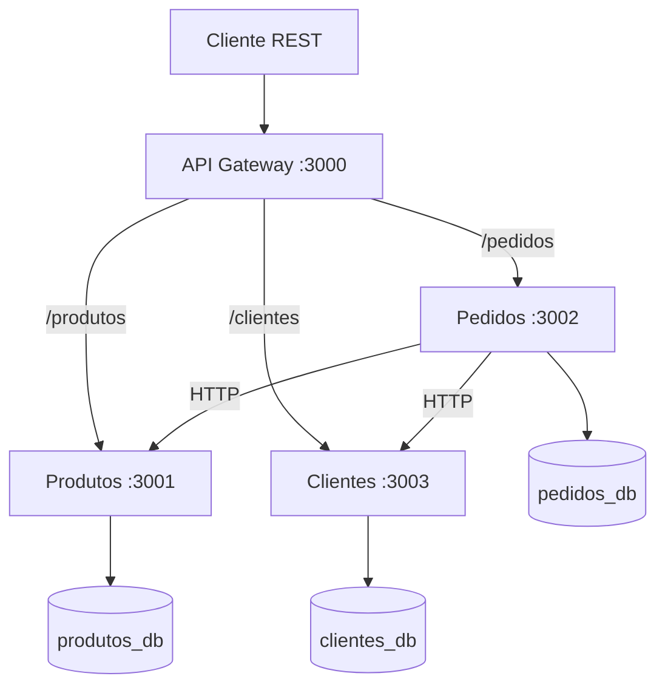

# Microserviços com Node.js

Projeto didático com três microserviços em Node.js, persistência em PostgreSQL e uma entrada única por API Gateway.

## Arquitetura



## Estrutura

```text
microservicos/
├── gateway/
├── produtos/
├── pedidos/
├── clientes/
├── banco/
│   └── init.sql
├── docker-compose.yml
└── README.md
```

## Tecnologias

- Node.js;
- Express;
- Axios;
- PostgreSQL;
- Docker e Docker Compose.

## Executar

Com o Docker Desktop iniciado, execute na pasta `microservicos/`:

```bash
docker compose up --build
```

Para encerrar:

```bash
docker compose down
```

Para apagar também os volumes e recriar os bancos:

```bash
docker compose down -v
```

## Endereços

| Serviço | Endereço |
| --- | --- |
| API Gateway | `http://localhost:3000` |
| Produtos | `http://localhost:3001` |
| Pedidos | `http://localhost:3002` |
| PostgreSQL | `localhost:5432` |

O acesso principal deve ser realizado pelo API Gateway, na porta `3000`.

## Requisições

### Criar produto

```http
POST http://localhost:3000/produtos
Content-Type: application/json

{
  "nome": "Teclado",
  "preco": 150
}
```

### Listar produtos

```http
GET http://localhost:3000/produtos
```

### Buscar produto

```http
GET http://localhost:3000/produtos/1
```

### Criar pedido

```http
POST http://localhost:3000/pedidos
Content-Type: application/json

{
  "produtoId": 1,
  "quantidade": 2
}
```

### Listar pedidos

```http
GET http://localhost:3000/pedidos
```

### Buscar pedido

```http
GET http://localhost:3000/pedidos/1
```

## Bancos de dados

Os três microserviços utilizam bancos separados na mesma instância PostgreSQL:

- `produtos_db`: dados do serviço de Produtos;
- `pedidos_db`: dados do serviço de Pedidos.

O campo `produto_id` armazenado em Pedidos é uma referência lógica. Não existe chave estrangeira entre os dois bancos.

## Atividade de Clientes

Execute os comandos desta seção dentro de `microservicos/`:

```powershell
docker compose up -d --build
docker compose ps
python testes/integracao.py
```

O teste cadastra cinco clientes, um produto e um pedido de demonstração por execução e verifica os erros de validação, duplicidade e referências inexistentes.

Clientes atende na porta 3003 e pelo Gateway na porta 3000:

- `GET /clientes`
- `GET /clientes/:id`
- `POST /clientes`

```json
{
  "nome": "Carlos",
  "sobrenome": "Oliveira",
  "telefone": "46991112222",
  "email": "carlos@example.com"
}
```

O cadastro retorna 201; campos inválidos retornam 400, e-mail duplicado retorna 409 e cliente inexistente retorna 404. O telefone é opcional. A aplicação normaliza o e-mail para minúsculas.

Para criar um pedido, use IDs retornados pela API:

```json
{
  "cliente_id": 1,
  "produtoId": 1,
  "quantidade": 3
}
```

Pedidos consulta Clientes e Produtos por HTTP antes de persistir. Cliente inexistente retorna 400; serviço indisponível retorna 503. Somente o identificador do cliente é armazenado em Pedidos, sem chave estrangeira entre bancos.

A tabela de Clientes é criada automaticamente na inicialização. Pedidos acrescenta `cliente_id` às tabelas preexistentes sem apagar registros; pedidos anteriores podem permanecer sem cliente, mas novos pedidos exigem o campo.

No pgAdmin externo ao Docker, registre o servidor com host `localhost`, porta `5433`, usuário `postgres` e senha `admin`. Abra `clientes_db > Schemas > public > Tables > clientes > View/Edit Data > All Rows`.

O script `banco/init.sql` cria os bancos na primeira inicialização do volume. Para volumes antigos sem `clientes_db`, execute:

```powershell
docker compose exec postgres psql -U postgres -c "CREATE DATABASE clientes_db;"
```

Na entrega individual, identifique os commits com `[Driver: Eduardo] [Navigator: Individual] descrição`. A demonstração inclui os containers, as três rotas pelo Gateway, os registros no pgAdmin e pedidos com cliente válido e inexistente.
